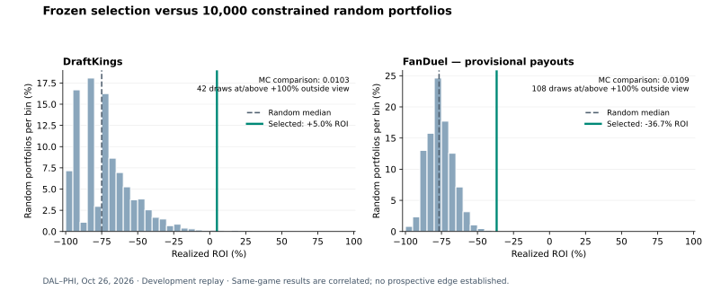

# DAL–PHI frozen portfolio replay — October 26, 2026

The archived selector exactly reproduced all 20 DraftKings and all 60 FanDuel
entered rosters. Each portfolio outperformed roughly 99% of 10,000 random
portfolios drawn from its own frozen 5,000-candidate pool under the same exposure
bounds. This is a development diagnostic on an already inspected game. It is not
an untouched historical backtest or proof of prospective profit.

| Measure | DraftKings Showdown | FanDuel Single Game |
|---|---:|---:|
| Portfolio entries | 20 | 60 |
| Entries reproduced exactly | 20 | 60 |
| Fees | $2.00 | $3.00 |
| Estimated returned prizes | $2.10 | $1.8991 |
| Realized ROI under saved payouts | +5.0% | −36.7% |
| Constrained random median ROI | −75.0% | −76.7% |
| Constrained random mean ROI | −46.3% | −70.8% |
| Random 95th percentile ROI | −35.0% | −58.7% |
| One-sided Monte Carlo comparison | 0.01030 | 0.01090 |
| Accepted / attempted random portfolios | 10,000 / 16,700 | 10,000 / 28,868 |

FanDuel monetary results are provisional: its saved payout profile is labeled
Thursday while this contest is Monday. The tiers sum to the advertised $7,000,
but that alone does not establish they are the correct Monday tiers. The earlier
$1.90 return estimate carries the same limitation.



## Frozen inputs and actual schema

Both calibration ZIPs use a root `manifest.json` with `schema: 1`, contest/slate
identity, capture times, platform/format, and a mapping of included file names to
byte lengths and SHA-256 hashes. Every listed attachment was verified.

- `player_pool.csv`: the captured player names, salaries, teams, positions and
  projections, including DK CaptainSalary when applicable.
- `candidates.csv` and `scored_lineups.csv`: the same 5,000 canonical rosters,
  with pregame `Top1` and other simulation metrics in the scored table.
- `opponent_field.csv`: the original simulated opponent rows, not final entrants.
- `inputs/contest.json`: contest ID, entry fee, expected field size, owned entries,
  prize pool and `[first_place, last_place, prize]` payout tiers.
- `solver/runtime_state.json`: tagged JSON dictionary
  `{"@":"dict","value":[[key,encoded_value],...]}`. Relevant frames carry
  `{"@":"frame","value":"<pandas table JSON>","attrs":...}`; tuples/lists use
  their own tags. Only captured control frames are decoded for this replay.
- `solver/evaluation_outcomes.npz`: numeric `values` with shape `(10000,29)` and
  string `names` with shape `(29,)`, loaded with `allow_pickle=False`. Its attrs
  JSON records engine and preparation identity. These pregame outcomes are
  validated but are not substituted for actual results in postgame scoring.
- `implementation/simmah_portfolio_selection.py`: byte-identical to the reviewed
  local selector, SHA-256
  `367bc9c4bd761aee9dbdbd9b70369a48d3b7a6ae60bd0cc0fa9de89da8357b0d`.

The package captures were 8:05:09 PM and 8:07:48 PM Eastern, respectively, before
the supplied 8:15 PM Eastern lock. The lock time comes from the DK salary file's
DAL–PHI Game Info; the FD replay uses the same game's cutoff. This is a capture
consistency check, not independent attestation that every upstream input was
available before lock.

DK standings are `contest-standings-197055079.zip`, containing a standings CSV
with `Rank, EntryId, EntryName, TimeRemaining, Points, Lineup`, followed by player
score/ownership columns. FD standings are `135830-281254012.csv`, with
`Rank, EntryId, EntryName, Points, Lineup` and player score/ownership/salary columns.
Neither package includes an exact final export checkpoint.

## Method fixed before inspecting replay results

The selector runs before the script opens standings, using frozen `Top1`,
50% diversity and the captured manual controls. Its effective overall exposure
cap is 80%, with per-player and special-role constraints retained. FD's rank
widget was not captured, so Top1 is explicitly assumed; the resulting roster
multiset matches all 60 actual entries. No archived Python is executed.

The baseline accepts 10,000 uniformly sampled portfolios of unique canonical
rosters, with seed 83 and without replacement within each portfolio. Complete
samples are rejected if they violate captured exposure bounds. Limits are not
inferred from the selected portfolio's realized exposures and are never relaxed.
This tests selection against a constrained random baseline, not against another
optimized selector.

For every hypothetical portfolio, remove the user's actual entries and insert
the complete replacement portfolio. Rank it against all remaining official
entries, including other members of the replacement portfolio. A tied group
shares the sum of all prize positions it occupies. Candidate scores come from
the platform's published base FPTS, including the 1.5x special role. DK's CPT
player-table FPTS is normalized back to base points; FD's first-listed MVP is
verified against the published score of every complete roster.

The empirical comparison is `(1 + number_of_random_returns_at_least_selected) /
(10000 + 1)`. It is conditional on this game's candidate pool, observed outcome,
saved payout schedule and constraints. The same-game DK/FD results are correlated
and must not be pooled as two independent successful slates.

## Structural checks and limitations

Published ranks reconcile to score-based ranks, entry IDs are unique, payout
tiers neither overlap nor exceed final contest size, and prize mass reconciles
to $4,000/$7,000. All candidate rosters satisfy captured salary ranges, six
different players and both teams. Repeated opponent lineups are legitimate and
are not classified as duplicate-entry errors.

DK has 47,562 final entries, matching its captured size; all TimeRemaining values
are zero. FD has 139,605 final listed entries versus a captured size of 167,664.
Replay uses the actual count, preserving all 1,040 blank, scoreless FD entries
at their verified bottom rank rather than silently dropping them or treating
them as zero-point rosters. FD has no TimeRemaining field, so final status cannot
be machine-proven from that column.

Actual and simulated field summaries are in the JSON reports. Their raw maximum
duplicate counts must not be directly compared across unequal sample sizes;
the reports also include the maximum lineup frequency as a proportion.

This does not exercise live Streamlit/IndexedDB restore, DK/FD upload acceptance,
or an export artifact that was not saved. Existing export and backup tests remain
separate. No app selection, scoring, exports or calibration parameters changed.

## Reproduce

From the repository root, with the already supplied files in `$INPUT_DIR`:

```bash
python scripts/run_slate_replay.py \
  --package "$INPUT_DIR/Simmah_NFL_DraftKings_Showdown_197055079_20261027T000509Z_15fa387795_Calibration_Solver.zip" \
  --standings "$INPUT_DIR/contest-standings-197055079.zip" \
  --username meitzlah78 --lock-time 2026-10-27T00:15:00+00:00 \
  --draws 10000 --seed 83 --output docs/benchmarks/replay-2026-10-26-dk.json

python scripts/run_slate_replay.py \
  --package "$INPUT_DIR/Simmah_NFL_FanDuel_Single_Game_135830-281254012_20261027T000748Z_a52181a768_Calibration_Solver.zip" \
  --standings "$INPUT_DIR/135830-281254012.csv" \
  --username meitzlah78 --lock-time 2026-10-27T00:15:00+00:00 \
  --draws 10000 --seed 83 --output docs/benchmarks/replay-2026-10-26-fd.json

python -m unittest discover -s tests -p test_slate_replay.py
python -m unittest discover -s tests -p test_portfolio_selection.py

python scripts/plot_slate_replay.py \
  docs/benchmarks/replay-2026-10-26-dk.json \
  docs/benchmarks/replay-2026-10-26-fd.json \
  --output docs/benchmarks/replay-2026-10-26.svg
```

The aggregate-only JSON reports are written atomically and include input/selector
hashes, random seed, capture/cutoff times, constraints, sample attempts, field
counts, outcome distributions, warnings and reconciliation results.

## Next validation

Freeze any revised selector before collecting new results, then retain a
chronological log across untouched game dates. Predeclare the baseline, metrics,
constraints and treatment of multiple platforms. Use game/slate-level uncertainty
and account for multiple comparisons. Ten or twenty slates are a starting target,
not a guarantee of adequate statistical power or proof of predictive value.
